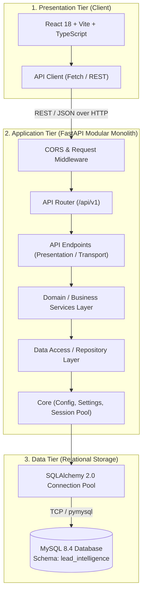

# NexLead — System Architecture Document

## 1. Architectural Overview

NexLead is designed as a genuine **Three-Tier Architecture** implemented as a **Modular Monolith**. It provides a robust, decoupled, and maintainable foundation for lead intelligence and sales operations without the operational complexity or overhead of microservices.

---

## 2. Tier Responsibilities & Boundaries

### Tier 1: Presentation Tier
- **Technology Stack**: React 18, Vite, TypeScript.
- **Location**: `frontend/`
- **Core Principle**: Pure client-side presentation and interaction.
  - **No Business Logic**: Components only handle display states, user input, and lifecycle triggers.
  - **No Direct Database Access**: Never accesses database drivers or queries.
  - **Strict REST Communication**: All interaction with the Application Tier occurs via strongly typed REST clients returning JSON.
  - **Security**: Zero access to database credentials or backend secrets. Uses `VITE_API_BASE_URL` exclusively.

### Tier 2: Application Tier
- **Technology Stack**: Python 3.13, FastAPI, Pydantic v2, SQLAlchemy 2.0.
- **Location**: `backend/`
- **Core Principle**: Centralized ownership of all business rules, orchestration, validation, and domain logic.
- **Internal Layering**:
  1. **Transport / Route Handlers (`backend/app/api/`)**:
     - Exposes RESTful JSON endpoints.
     - Performs request routing and HTTP status handling.
     - **Strict Rule**: No SQL queries, raw connection calls, or heavy business logic inside route handlers.
  2. **Application / Service Layer (`backend/app/services/`)**:
     - Coordinates operations, applies domain rules, computes scores, and manages workflows.
     - Interacts with Repositories for persistence.
  3. **Data Access / Repository Layer (`backend/app/repositories/`)**:
     - Dedicated data access objects (DAOs).
     - Isolates all SQLAlchemy ORM operations and SQL statements from business logic.
  4. **Validation & Schemas (`backend/app/schemas/`)**:
     - Pydantic models enforcing strict contract validation for incoming requests and outgoing responses.
  5. **Core & Infrastructure (`backend/app/core/`)**:
     - Environment configuration via `pydantic-settings`.
     - Connection pooling (`pool_pre_ping=True`, `pool_recycle=3600`), transaction session lifecycle management (`get_db` dependency).

### Tier 3: Data Tier
- **Technology Stack**: MySQL 8.4.
- **Database Name**: `lead_intelligence`
- **Core Principle**: Authoritative, persistent, relational data store.
  - ACID transactional integrity.
  - Accessed exclusively by the Application Tier via SQLAlchemy connection pool.

---

## 3. Communication Protocols

| Communication Boundary | Protocol | Format | Description |
| :--- | :--- | :--- | :--- |
| **Presentation Tier $\leftrightarrow$ Application Tier** | HTTP / HTTPS | JSON | Asynchronous REST calls. Configured with explicit CORS origin whitelisting (`ALLOWED_ORIGINS`). |
| **Application Tier $\leftrightarrow$ Data Tier** | TCP (Port 3306) | MySQL Binary Protocol | Managed SQLAlchemy session connections using `pymysql` driver with pre-ping validation. |

---

## 4. Configuration & Security

1. **Environment Separation**:
   - Environment variables control configuration (`backend/.env`, `frontend/.env`).
   - `.env.example` templates are provided with no real credentials.
2. **Credential Safety**:
   - Database credentials are kept strictly in backend environment variables and never exposed to the frontend or source control.
   - Root `.gitignore` prevents `.env`, virtual environments, build artifacts, and caches from entering Git.
3. **CORS Governance**:
   - The FastAPI backend explicitly validates `Origin` headers against `ALLOWED_ORIGINS` (e.g., `http://localhost:5173`).

---

## 5. Architectural Health & Verification Design

The architecture includes built-in verification endpoints:
- `GET /health`: Basic application tier liveness probe.
- `GET /api/v1/health`: API version 1 health check.
- `GET /api/v1/health/db`: Deep verification of the data tier, executing a round-trip query (`SELECT 1, VERSION(), DATABASE()`) through `HealthRepository` and reporting engine status, database name, and latency in milliseconds.
- `GET /api/v1/health/detailed`: Aggregated status spanning Presentation, Application, and Data tiers.

